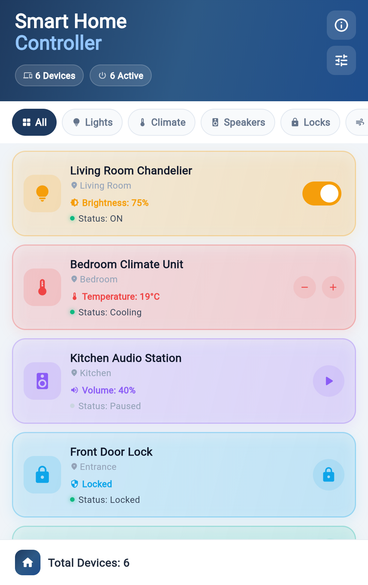
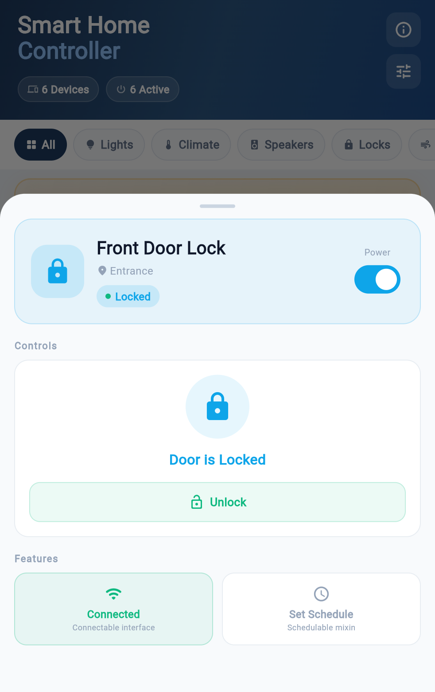
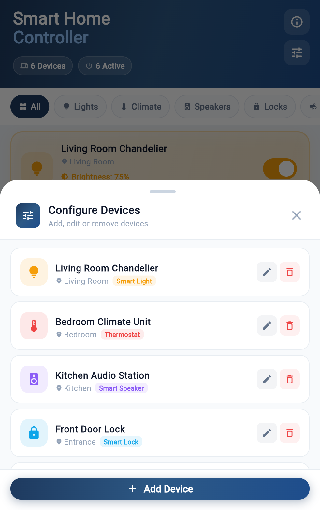
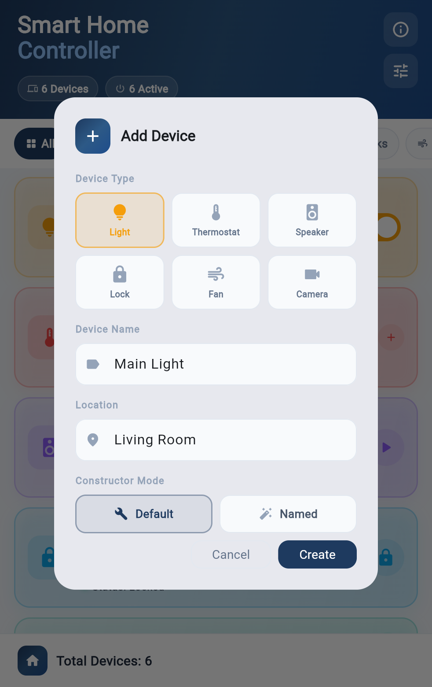
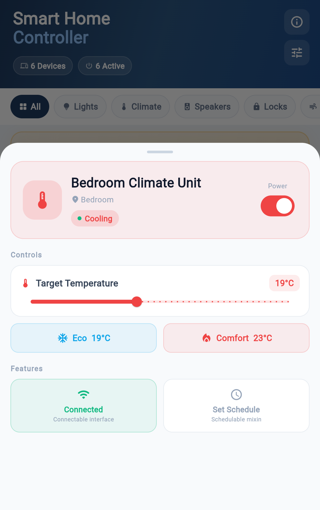
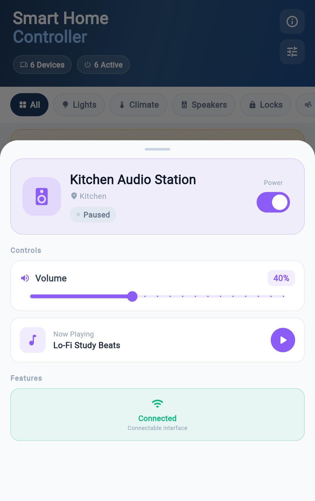

# Flutter Fundamentals & Practices

> **IMPORTANT NOTE**  
> For privacy and security reasons, personal/student information is not stored in this public repository. All required student and submission details are provided in the submitted assignment PDF report.

---

## 01-campus-event-explorer

| | | |
| :---: | :---: | :---: |
|  |  |  |
|  |  |  |

---

## 02-smart-home-controller

| | | |
| :---: | :---: | :---: |
|  |  |  |
|  |  |  |
